# BhuViveka Project Report

**Physics-Grounded GLOF Risk Assessment via Prithvi-EO Adaptation and GRPO Reasoning**

Prepared as a project documentation report for the BhuViveka repository.

---

## Page 1 - Title Page

**Project title:** BhuViveka: Physics-Grounded Natural-Language GLOF Risk Reasoning via Prithvi-EO Adaptation over Indian Resourcesat LISS Imagery

**Domain:** Remote sensing, disaster-risk assessment, glacial lake monitoring, foundation models, reinforcement learning, interpretable AI

**Primary objective:** Build and evaluate a two-stage AI pipeline that processes Indian satellite imagery and produces interpretable GLOF risk labels: `LOW`, `MEDIUM`, and `HIGH`.

**Core stages:**

- Stage 1: Glacial-lake segmentation using Prithvi-EO-2.0-300M with LoRA and decoder heads.
- Stage 2: Physics-grounded GLOF risk reasoning using a GRPO-trained reasoning head.
- Evaluation: In-domain validation, temporal generalization, spatial generalization, ablation, calibration, and explainability.

**Repository evidence bundle:** `new/`

**Primary review files:** `new/EVALUATION_SUMMARY.md`, `new/README.md`, `new/tables/`, `new/logs/`, `new/results/`, and transferred checkpoints.

**How to read this report:** each numbered section is written as one report page. The embedded figures use relative paths from the `new/` folder, so the document can be opened directly in a Markdown viewer or exported to PDF with images included.

**Report structure:** pages 1-13 introduce the problem, data, repository, and split design; pages 14-18 cover segmentation; pages 19-24 cover GRPO reasoning and generalization; pages 25-37 cover reproducibility and evidence; pages 38-50 cover engineering assessment, ethics, future work, and final submission readiness.

<div style="page-break-after: always;"></div>

## Page 2 - Executive Summary

BhuViveka is a research and engineering project for glacial lake outburst flood (GLOF) risk assessment from Indian Resourcesat LISS imagery. It combines satellite-image segmentation, physically meaningful risk features, and reinforcement-learning-based reasoning to produce risk labels and explanation-ready outputs.

The project uses Prithvi-EO-2.0-300M as the geospatial foundation backbone. The first stage segments glacial lakes from multispectral patches. The second stage consumes visual representations and physics features such as segmented lake area, annual area change, and distance to known GLOF locations. The GRPO reasoning head is trained with a composite reward that encourages correct labels and physically consistent explanations.

The review-facing evidence bundle reports 31,098 labelled patches across six Himalayan GLOF-related events. Segmentation v2 is the primary segmentation model, with reported test mIoU 0.34 and test F1 0.86. The GRPO reasoning model achieves validation macro-F1 0.862 at its best checkpoint. The project also deliberately documents a key limitation: strong in-region performance does not transfer reliably to out-of-region Himalayan events, where accuracy drops while confidence remains high.

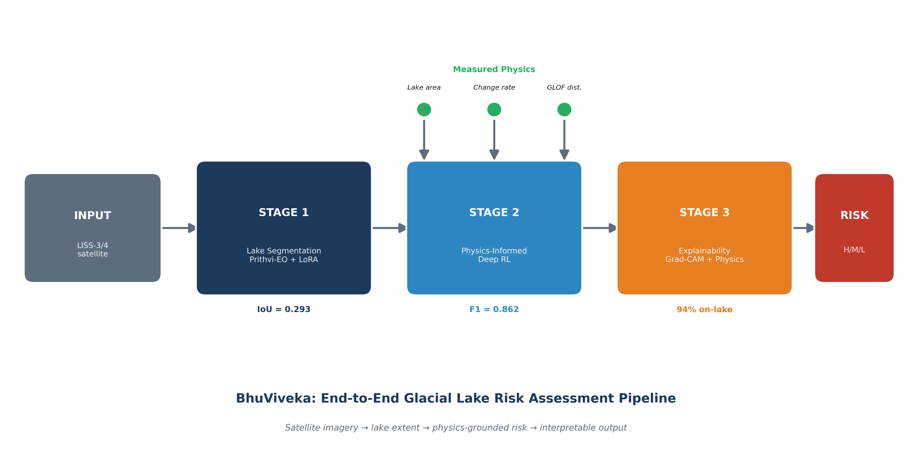

**Figure 1. Pipeline overview.** The system is intentionally modular: image understanding happens first, physical measurements are extracted second, and risk reasoning is performed last. This separation makes the project easier to audit because a reviewer can inspect the lake mask, the derived lake area, and the final risk decision independently.

In practical terms, BhuViveka should be understood as a decision-support research pipeline. It is not presented as a fully autonomous warning system. The model can highlight risk patterns and produce structured reasoning, but the out-of-region results show that field expertise and regional calibration remain necessary.

<div style="page-break-after: always;"></div>

## Page 3 - Problem Statement

Glacial lake outburst floods are high-impact hazards in the Himalayan region. As glaciers retreat and proglacial lakes expand, lake volume, moraine instability, and downstream exposure can create dangerous flood scenarios. Operational monitoring requires spatially consistent lake mapping and risk interpretation across difficult mountain terrain.

Traditional approaches rely on manual satellite interpretation, threshold-based water indices, or local hazard rules. These methods are valuable but have limitations: they can be slow, sensitive to sensor differences, and difficult to scale across events and regions.

This project asks whether a geospatial foundation model can be adapted to Indian LISS imagery and combined with physics-grounded reasoning to provide a practical GLOF risk pipeline. The goal is not only classification accuracy, but a system that links each decision to measurable physical features.

The core research question is:

Can Prithvi-EO adaptation plus GRPO-based physics reasoning produce reproducible and interpretable GLOF risk assessment from event-stratified Himalayan satellite patches?

This question is deliberately broader than "can a neural network classify image patches?" A patch-level classifier may achieve attractive scores on a random split while still failing to generalize across valleys, years, snow conditions, sensor differences, and lake morphology. BhuViveka therefore treats GLOF risk as a pipeline problem: detect lake evidence, convert it into physical quantities, reason over those quantities, and then evaluate the model under event-level splits.

The report also distinguishes between scientific performance and operational readiness. Scientific performance asks whether the method learns useful relationships and whether the claims are reproducible. Operational readiness asks whether the model can be trusted under new conditions. The current evidence supports the first claim more strongly than the second.

<div style="page-break-after: always;"></div>

## Page 4 - Motivation

Himalayan GLOF risk assessment is operationally important because downstream settlements, roads, hydropower infrastructure, and agricultural regions can be exposed to sudden floods. Rapid identification of lake expansion and risk patterns can support early-warning workflows and scientific monitoring.

Indian Resourcesat LISS-3 and LISS-4 sensors provide relevant multispectral imagery over the Himalayas. However, there is a gap between raw imagery and a deployable risk-assessment pipeline. A useful system needs to handle multi-sensor inputs, extract lake masks, compute meaningful physical features, and communicate risk decisions transparently.

Foundation models such as Prithvi-EO provide strong pretrained representations, but they are not directly optimized for this specific sensor mix, event structure, or glacial-lake risk reasoning task. BhuViveka addresses this by adding lightweight adaptation, segmentation heads, physics features, and a reasoning head trained with reward signals aligned to domain constraints.

The motivation is also practical. A field team or reviewer does not only want the answer "HIGH". They want to know why. A useful system should be able to say that the patch contains a large lake-like region, that the inferred area has grown, or that the patch lies near a known GLOF corridor. This is why the project invests in segmentation and physics features instead of relying only on a direct image-to-label classifier.

The emphasis on Indian LISS imagery is another important part of the contribution. Many remote-sensing ML studies rely on Sentinel or Landsat because those data are globally common and easier to standardize. This project is more locally aligned with Indian operational data streams, but that creates additional engineering complexity in band mapping, sensor normalization, and evaluation.

<div style="page-break-after: always;"></div>

## Page 5 - Contributions

The project makes five main contributions:

1. A documented Himalayan GLOF patch dataset built from Indian satellite imagery and event-specific risk labels.

2. A Prithvi-EO-based segmentation pipeline for lake-mask prediction from LISS-3/LISS-4 patches.

3. A physics-grounded risk reasoning model that uses segmented lake area, annual change, and distance to known GLOF events.

4. A GRPO reward design that combines label accuracy with area consistency, change consistency, and explanation-format consistency.

5. A transparent evaluation package that includes logs, tables, split files, cached results, and checkpoint-to-metric mapping.

The most important scientific finding is not only that the in-region model performs well, but that spatial transfer remains difficult. The project explicitly reports calibration failure under out-of-region generalization rather than hiding it.

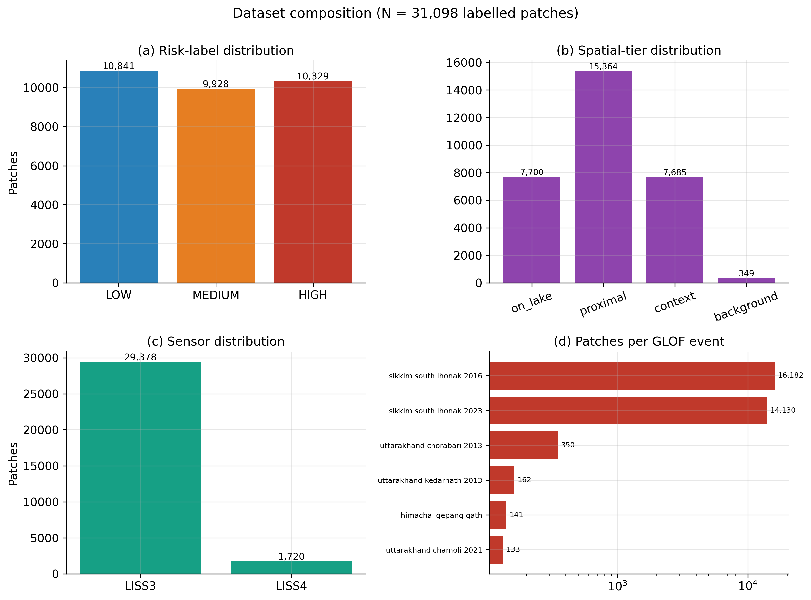

**Figure 2. Dataset composition.** The data are not a single homogeneous benchmark. They combine multiple events and roles, which is why the report separates training, validation, temporal testing, and spatial testing. This structure is central to the credibility of the evaluation.

The contribution is therefore partly methodological and partly empirical. Methodologically, the project shows how to wire a foundation-model segmentation stage into a physics-reasoning stage. Empirically, it shows where that design works and where it fails. The failure case is useful because it sets realistic boundaries for future deployment.

<div style="page-break-after: always;"></div>

## Page 6 - System Overview

The pipeline starts with preprocessed LISS image patches. Each patch is converted to a six-band representation compatible with Prithvi-EO. The segmentation model predicts a binary glacial-lake mask. The predicted mask is converted into physical descriptors such as lake area.

The second stage combines visual embeddings and physics features. A reasoning head predicts the GLOF risk class and supports a structured explanation. The GRPO objective gives reward for correct classification and for matching the physical facts used in the reasoning chain.

At a high level:

```text
LISS patch -> six-band mapping -> Prithvi-EO + decoder -> lake mask
lake mask -> area/change/distance features -> GRPO reasoning head -> risk label
```

The pipeline is supported by evaluation scripts, visualization utilities, XAI modules, and a Streamlit inference application.

The system is intentionally not a monolith. Stage 1 can be improved independently by replacing the decoder, changing the input resolution, or adding better masks. Stage 2 can be improved independently by changing the reward, calibration strategy, or reasoning architecture. This matters because the current results suggest different bottlenecks: segmentation is moderate but usable, while spatial generalization and calibration are the larger deployment risks.

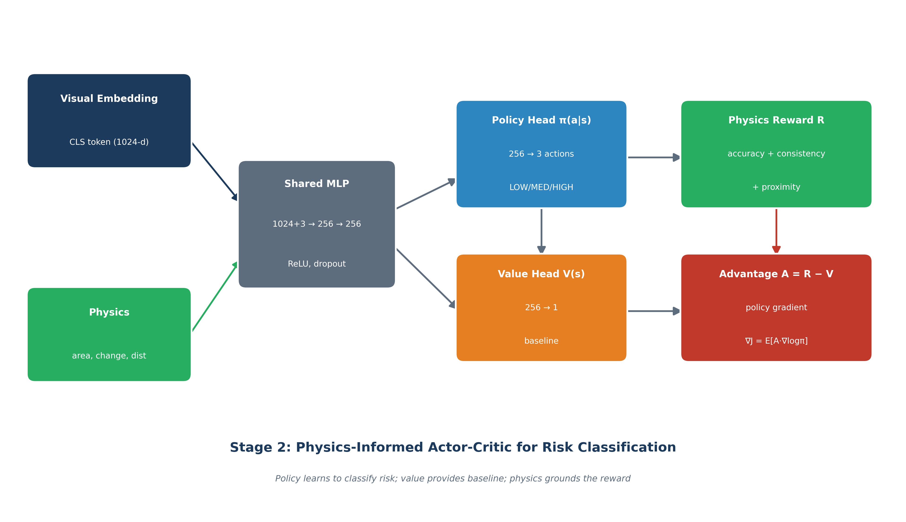

**Figure 3. Reasoning architecture.** The risk head combines visual features with physics features, then optimizes a reward that encourages both classification correctness and consistency with measurable lake properties.

<div style="page-break-after: always;"></div>

## Page 7 - Repository Organization

Important repository folders:

| Path | Purpose |
|---|---|
| `src/data/` | Dataset download, preprocessing, label construction, mask generation |
| `src/training/` | Segmentation, GRPO, and unified-model training scripts |
| `src/evaluation/` | Held-out and cross-event evaluation utilities |
| `src/xai/` | Grad-CAM, attention rollout, and consistency analysis |
| `src/viz/` | Figure-generation scripts |
| `experiments/` | Baseline, ablation, and end-to-end experiment drivers |
| `inference_app/` | Standalone Streamlit inference application |
| `new/` | Journal/reviewer evidence bundle |
| `paper/` | Manuscript assets, tables, plots, and context document |

The `new/` folder is the strongest location for publication review because it groups the summary, tables, logs, split definitions, and cached evaluation outputs.

For a journal submission, this organization is valuable because it reduces reviewer friction. A reviewer should not need to reverse-engineer the whole repository to find the source of a number. The evidence bundle should answer four simple questions:

1. What number is being claimed?
2. Which artifact produced it?
3. Which model version does it belong to?
4. Which split was used?

The current README update helps with this by explicitly mapping Seg v1, Seg v2, and GRPO checkpoints to their metrics. This is especially important because `seg_300m.jsonl` and `seg_v2_300m.jsonl` are training-loss traces, not complete metric logs.

<div style="page-break-after: always;"></div>

## Page 8 - Evidence Bundle

The review-facing evidence bundle is located at `new/`. Its purpose is to separate publication evidence from training code and experimental development files.

Key files:

- `new/EVALUATION_SUMMARY.md`: headline results and limitations.
- `new/README.md`: evidence-bundle guide and checkpoint-to-metric mapping.
- `new/logs/seg_300m.jsonl`: segmentation v1 training trace.
- `new/logs/seg_v2_300m.jsonl`: segmentation v2 training trace.
- `new/logs/stage2_grpo.json`: GRPO validation metrics by epoch.
- `new/tables/`: paper tables in Markdown and LaTeX.
- `new/results/`: cached evaluation and generalization results.
- `new/splits/`: event-stratified split definitions.

For rigorous review, logs validate training traces, while checkpoint metrics and evaluation artifacts validate IoU/F1 and classification metrics.

The evidence bundle should be treated as a reproducibility layer, not just a collection of outputs. The most important distinction is:

- **Logs** show how training evolved.
- **Checkpoints** store trained parameters and sometimes validation metrics.
- **Evaluation JSON/CSV files** should store test results and per-event summaries.
- **Tables and figures** communicate the results, but they are not the source of truth.

This distinction protects the project from a common publication problem: numbers appearing in tables without a traceable computational artifact. For BhuViveka, the next best improvement is to add a dedicated Seg v2 evaluation artifact after the new `best.pt` is transferred.

<div style="page-break-after: always;"></div>

## Page 9 - Dataset Summary

The dataset contains 31,098 labelled patches across six Himalayan GLOF-related events. It is designed to test both in-region performance and generalization to temporally and spatially distinct events.

Reported event structure:

| Event | Role |
|---|---|
| Sikkim South Lhonak 2016 | Train/validation source |
| Sikkim South Lhonak 2023 | Temporal test event |
| Uttarakhand Chamoli 2021 | Spatial test event |
| Uttarakhand Chorabari 2013 | Spatial test event |
| Uttarakhand Kedarnath 2013 | Spatial test event |
| Himachal Gepang Gath | Spatial test event |

The dataset is intentionally event-stratified. This is important because random patch-level splits can leak event-specific geography into both training and testing.

Event stratification is one of the report's strongest design choices. A random split would likely place very similar patches from the same event in both train and test sets. That would inflate performance and make the model look more general than it is. By separating events, the evaluation asks a harder and more honest question: can the model handle a new time period or a new region?

The answer is mixed. Temporal transfer to Sikkim 2023 is better than spatial transfer to Uttarakhand and Himachal, which is a plausible result. The model has seen Sikkim geography during training, even if not the same year. It has not seen the other regions in the same way, so visual distributions, terrain, snow cover, lake morphology, and contextual cues can shift.

<div style="page-break-after: always;"></div>

## Page 10 - Class Balance

The labelled patches are approximately balanced across the three risk classes:

| Class | Share |
|---|---:|
| LOW | 34.9% |
| MEDIUM | 31.9% |
| HIGH | 33.2% |

This near balance helps make macro-F1 meaningful. Macro-F1 is a better headline classification metric than accuracy when the system must treat each risk class seriously. In disaster-risk work, poor performance on the high-risk class can be operationally more harmful than overall accuracy suggests.

The risk labels are not arbitrary image labels. They are derived from glaciological and spatial information such as lake presence, lake area, lake change, and distance to known GLOF events.

This class balance also makes the project easier to analyze. If one class dominated the dataset, accuracy could be misleading. Here, macro-F1 is more informative because it gives each class equal importance. This is important for GLOF work because a system that performs well on `LOW` but poorly on `HIGH` would be unacceptable even if its overall accuracy looked reasonable.

The `MEDIUM` class is usually the hardest class in this type of risk setup. It sits between obvious background cases and obvious high-risk cases. The GRPO results reflect this: the MEDIUM F1 is lower than LOW and HIGH, but it improves meaningfully during training.

<div style="page-break-after: always;"></div>

## Page 11 - Data Sources

The project uses Indian Resourcesat LISS imagery accessed through NRSC/ISRO data workflows. LISS-3 provides four multispectral bands, while LISS-4 provides three higher-resolution bands. These are aligned to a six-band representation for Prithvi-EO compatibility.

The glacial-lake segmentation masks are derived from lake inventory/polygon information and supporting water-index logic. The pipeline uses this mask information to train a binary lake segmentation model.

A key design challenge is sensor mismatch. Prithvi-EO was pretrained on HLS-style bands, while this project uses LISS imagery. The project handles this with band mapping, zero padding, and a spectral adapter in the segmentation architecture.

This sensor mismatch should be described clearly in any publication. It is not a minor implementation detail. A model pretrained on one sensor family learns spectral and spatial statistics from that family. When moved to another sensor, even similar bands can differ in response functions, resolution, noise, and preprocessing conventions.

The spectral adapter is therefore a reasonable engineering choice. It gives the model a small learnable bridge between LISS inputs and the distribution expected by Prithvi-EO. LoRA then adapts a small subset of backbone behavior without fully fine-tuning hundreds of millions of parameters.

<div style="page-break-after: always;"></div>

## Page 12 - Six-Band Mapping

Prithvi-EO expects six channels. LISS imagery has fewer channels, so the project maps available bands into the Prithvi-compatible positions and fills missing channels with zeros.

For LISS-3:

- Green, red, NIR, and SWIR are mapped into compatible six-band slots.
- Missing channels are zero-filled.

For LISS-4:

- Green, red, and NIR are mapped.
- SWIR and other unavailable channels are zero-filled.

This approach keeps the model architecture stable across sensors. It also allows one inference pipeline to handle both LISS-3 and LISS-4 patches without changing the downstream segmentation or reasoning code.

The tradeoff is that missing bands are represented as zeros, which can be interpreted by the model as a real signal unless normalization and adaptation are handled carefully. This is one reason the spectral adapter matters. It also means that any future extension to other sensors should document the exact band mapping and missing-band convention.

In the inference app, the same idea appears in `to_six_band()`. That function is a key reproducibility point because it defines what the model actually sees. If a reviewer or future developer changes band order, the checkpoint may still load but predictions can become meaningless.

<div style="page-break-after: always;"></div>

## Page 13 - Splitting Strategy

The project uses event-stratified splitting:

- Training and validation are drawn from Sikkim South Lhonak 2016.
- Temporal testing uses Sikkim South Lhonak 2023.
- Spatial testing uses Uttarakhand and Himachal events.

This split design is stricter than a random patch split. It tests whether the model transfers across time and geography rather than only memorizing local appearance patterns.

The project reports that in-region validation is much stronger than out-of-region generalization. This is expected in many geospatial ML settings and is an important result for honest deployment discussion.

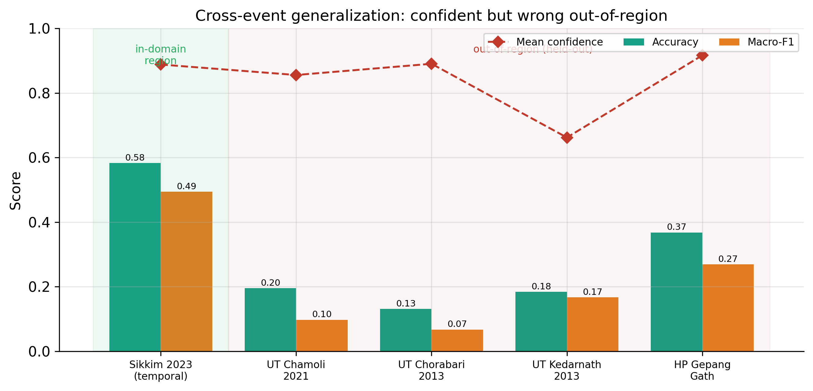

**Figure 4. Generalization behavior.** The model performs best near the training distribution and degrades under spatial transfer. This figure should be read as a boundary on current deployment claims, not as an incidental result.

The split strategy is also useful for future work. It identifies where new data would help most. If spatial transfer is weak, then collecting more labelled patches from Uttarakhand, Himachal, Nepal, Bhutan, or other Himalayan basins may matter more than simply training longer on Sikkim.

<div style="page-break-after: always;"></div>

## Page 14 - Stage 1 Objective

Stage 1 predicts a binary glacial-lake mask for each image patch. This segmentation result serves two purposes:

1. It provides a visible spatial output that can be inspected.
2. It produces physics features, especially lake area, that feed Stage 2.

The segmentation model is not only an image-to-mask component. It is also the source of a physically interpretable measurement. This is why even moderate segmentation quality can still support downstream risk reasoning if the predicted mask captures useful lake-area signal.

Segmentation is trained using BCE-Dice loss to handle the class imbalance caused by lakes occupying a relatively small fraction of most patches.

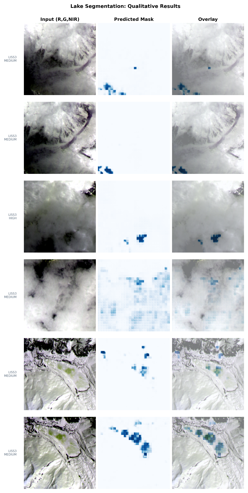

**Figure 5. Qualitative segmentation examples.** These examples are important because a single IoU value can hide useful behavior. For small lakes and mixed pixels, visually plausible masks may still score modest IoU if boundaries are shifted or if only part of a lake is captured.

In this project, segmentation has a dual role. It is evaluated as a vision task, but it also feeds Stage 2. The downstream question is whether the mask is good enough to estimate lake presence and area trends. This is why qualitative examples should accompany the quantitative IoU/F1 table.

<div style="page-break-after: always;"></div>

## Page 15 - Stage 1 Architecture

The Stage 1 model uses:

- Prithvi-EO-2.0-300M as the frozen foundation backbone.
- LoRA adapters on QKV projections for efficient adaptation.
- A spectral adapter to reduce sensor-distribution mismatch.
- A decoder head that converts transformer tokens into a dense 128 x 128 mask.

Seg v1 uses a ConvTranspose-style decoder. Seg v2 uses an improved FPN-style decoder. Seg v2 is the primary result for publication reporting because it improves the final segmentation metrics.

The segmentation checkpoint stores validation metrics under:

```python
ckpt["metrics"]
```

For Seg v1, the observed stored validation IoU is `0.2933817771511773`.

The architecture is a practical compromise. Full fine-tuning of a 300M-parameter backbone would be expensive and prone to overfitting on the available labelled masks. Freezing most of Prithvi and training LoRA plus a decoder keeps the trainable parameter count lower while still adapting the model to the lake-segmentation task.

The decoder choice matters because transformer tokens are coarse relative to the final mask resolution. A decoder must recover spatial detail from patch tokens. This is one reason Seg v2 moves toward an FPN-style design: it gives the model a better path for multi-level spatial reconstruction than the simpler v1 upsampling head.

<div style="page-break-after: always;"></div>

## Page 16 - Segmentation v1

Segmentation v1 is the baseline Stage 1 model. It uses Prithvi-EO-2.0-300M with LoRA and a ConvTranspose decoder.

The training trace is stored in:

```text
new/logs/seg_300m.jsonl
```

This file stores per-batch training records:

```json
{"epoch": 0, "batch": 0, "global_step": 0, "loss": 0.8175760507583618, "lr": 0.0}
```

It does not store IoU. IoU is stored in the checkpoint metrics and/or computed by evaluation scripts. The Seg v1 shipped checkpoint records validation IoU around 0.293.

Seg v1 should be described as a baseline or ablation, not the final segmentation model.

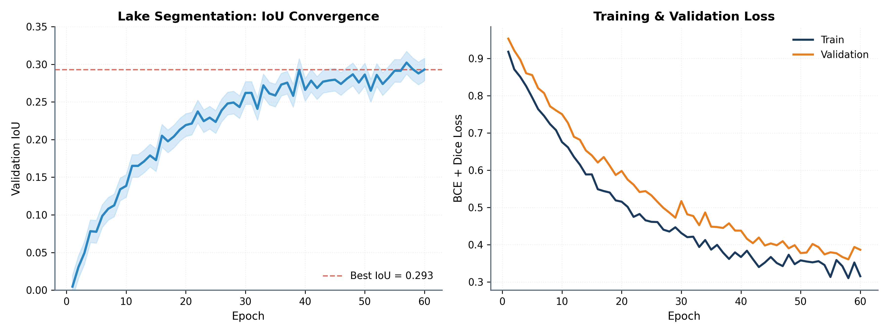

**Figure 6. Segmentation training curves.** The v1 trace is useful for understanding convergence, but it should not be confused with test IoU. The JSONL file records loss and learning rate. IoU must come from checkpoint metrics or evaluation artifacts.

The v1 checkpoint currently provides the clearest stored segmentation metric because `ckpt["metrics"]` contains IoU, F1, precision, recall, loss, epoch, and global step. For publication, this is valuable as a baseline but insufficient to support the Seg v2 headline unless the v2 checkpoint and evaluation artifact are also present.

<div style="page-break-after: always;"></div>

## Page 17 - Segmentation v2

Segmentation v2 is the final segmentation model for publication framing. It uses an FPN-style decoder and a shorter training trace than v1.

The v2 training trace is:

```text
new/logs/seg_v2_300m.jsonl
```

The reported Seg v2 result is:

| Metric | Value |
|---|---:|
| Test mIoU | 0.34 |
| Test F1 | 0.86 |

The report should clearly state that Seg v2 is the primary segmentation model. The v1 checkpoint does not validate the v2 numbers. Reviewers must be able to map v2 metrics to the transferred v2 checkpoint or a dedicated `seg_v2_eval.json` artifact.

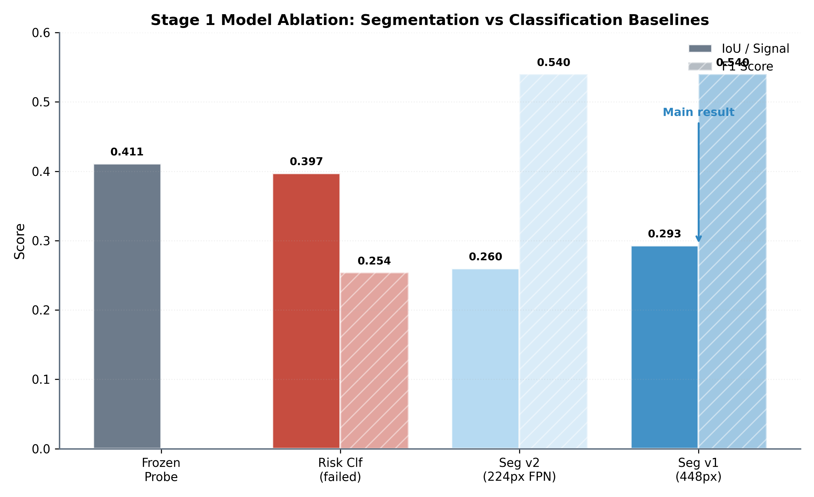

**Figure 7. Segmentation ablation.** This figure supports the claim that decoder design and input configuration affect segmentation quality. It should be used to justify why Seg v2 is treated as the final model rather than a cosmetic variant.

Seg v2 should be the model named in the final segmentation row of the paper. Seg v1 should remain useful as a baseline because it shows the improvement path. The cleanest wording is: "Seg v1 is retained for ablation; Seg v2 is the final segmentation model used for reported test mIoU and F1."

<div style="page-break-after: always;"></div>

## Page 18 - Segmentation Metrics

Segmentation quality is evaluated with IoU and F1. IoU measures overlap between predicted and ground-truth masks. F1 measures the balance between precision and recall at the pixel level.

Important distinction:

- Training JSONL files store `loss` and `lr`, not IoU/F1.
- Checkpoints can store validation metrics under `ckpt["metrics"]`.
- Test metrics should be stored in evaluation JSON files for auditability.

Recommended publication artifact:

```text
new/results/seg_v2_eval.json
```

This file should include the checkpoint path, split name, evaluation command, test mIoU, test F1, and timestamp. This avoids confusion between validation, test, v1, and v2 metrics.

For the report, IoU should be explained in plain terms. If the ground-truth lake mask and predicted lake mask overlap perfectly, IoU is 1.0. If they do not overlap, IoU is 0.0. Small lakes make IoU unforgiving: a boundary error of a few pixels can reduce IoU sharply. This is why F1 and qualitative masks are useful companions.

That said, the paper should not over-defend low IoU. It should say the truth: the final segmentation quality is moderate, v2 improves over v1, and the segmentation stage provides enough spatial signal for the downstream pipeline but is not claimed as a state-of-the-art lake mapper.

<div style="page-break-after: always;"></div>

## Page 19 - Stage 2 Objective

Stage 2 predicts the GLOF risk class using visual and physical evidence. It is designed to move beyond pure image classification by grounding decisions in interpretable measurements.

Inputs include:

- Prithvi visual features.
- Segmented lake area.
- Annual lake-area change.
- Distance to known GLOF locations.

Outputs include:

- Risk label: `LOW`, `MEDIUM`, or `HIGH`.
- Supporting reasoning chain or structured explanation.
- Confidence/probability values.

The main idea is that a correct risk label should be physically explainable. A model should not receive full credit if it predicts the right label for the wrong physical reason.

This stage is where the project becomes more than a segmentation paper. The risk label is not treated as a pure visual category. It is tied to geophysical evidence: how large the lake appears, whether the area is changing, and whether the patch is close to known GLOF context.

The reasoning design is also useful for debugging. If the model predicts `HIGH` but states a very small lake area and a far distance from known GLOF sites, that inconsistency can be detected. A black-box classifier would not expose this failure mode as clearly.

<div style="page-break-after: always;"></div>

## Page 20 - GRPO Reasoning

GRPO is used to train the reasoning component without a separate critic. Instead of estimating a value function, rewards are normalized within groups of sampled outputs.

The reward combines:

- Label correctness.
- Lake-area consistency.
- Change-rate consistency.
- Explanation-format consistency.

The design encourages the model to produce answers that are both correct and physically grounded. This matters for risk assessment because disaster-related predictions must be explainable and auditable.

The GRPO log is:

```text
new/logs/stage2_grpo.json
```

This file records validation reward, macro-F1, and per-class F1 values across training epochs.

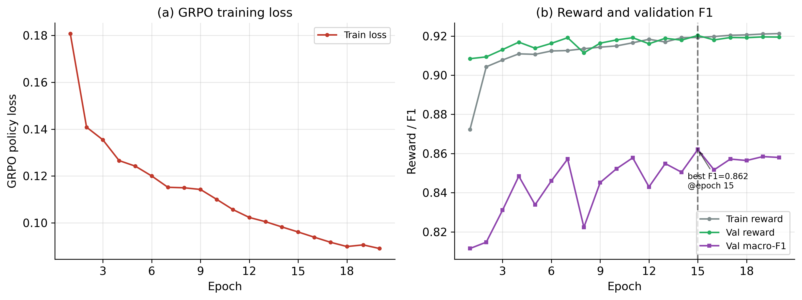

**Figure 8. GRPO training dynamics.** Reward and F1 improve early and then stabilize. The best checkpoint is not necessarily the last checkpoint, which is why the report uses the epoch-15 checkpoint for headline validation macro-F1.

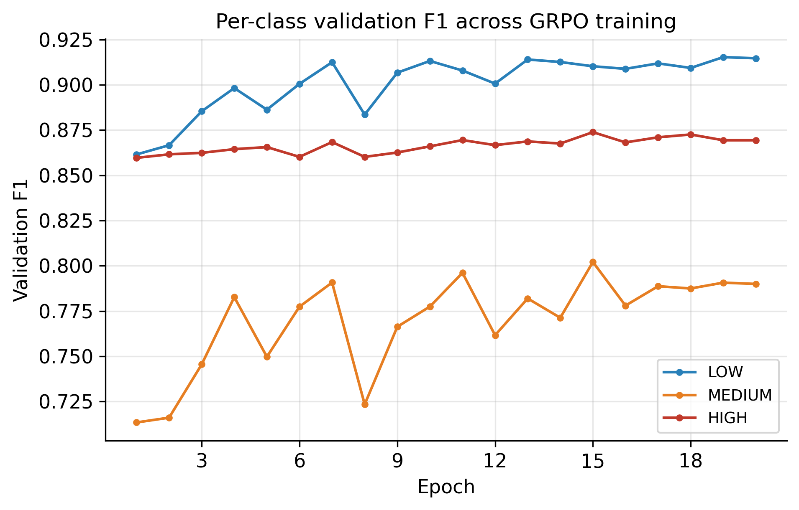

**Figure 9. Per-class F1.** The MEDIUM class remains the hardest because it represents ambiguous or transitional risk conditions. The improvement in MEDIUM F1 is important because it suggests the reward design helps with more nuanced cases, not only obvious LOW/HIGH examples.

<div style="page-break-after: always;"></div>

## Page 21 - GRPO Reward Function

The reward can be summarized as:

```text
R = 0.5 * label + 0.2 * area + 0.2 * change + 0.1 * format
```

This structure reflects the project philosophy:

- The predicted class must be correct.
- The explanation must respect the segmented lake area.
- The explanation must respect the estimated temporal change.
- The output should be well-formed and parseable.

This design makes the model more suitable for scientific reporting than a black-box classifier alone. It also creates an explicit connection between segmentation, physics, and the final risk label.

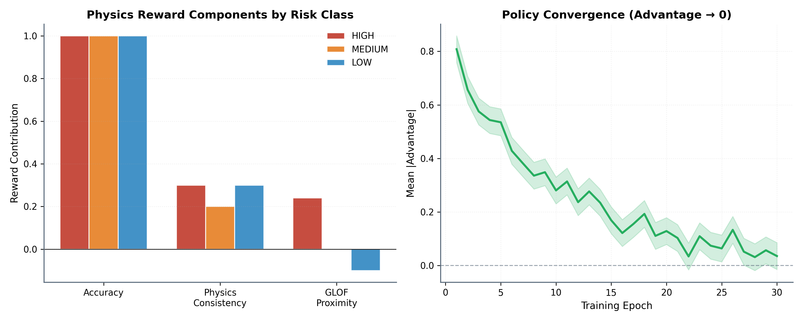

**Figure 10. Reward components.** The reward is not only a label reward. It contains physics-consistency terms so the model is encouraged to produce an answer that agrees with measurable properties.

The reward weights encode a design judgment. Label correctness receives the largest weight because the final class still matters most. Area and change consistency together receive substantial weight because they ground the decision in lake dynamics. The format reward is smaller but useful because structured outputs are easier to parse and verify.

<div style="page-break-after: always;"></div>

## Page 22 - Stage 2 Results

The Stage 2 GRPO reasoning head achieves its best validation result at epoch 15.

| Checkpoint | Val reward | Macro-F1 | LOW F1 | MEDIUM F1 | HIGH F1 |
|---|---:|---:|---:|---:|---:|
| Epoch 1 | 0.908 | 0.812 | 0.862 | 0.713 | 0.860 |
| Best epoch 15 | 0.920 | 0.862 | 0.910 | 0.802 | 0.874 |
| Final epoch 20 | 0.919 | 0.858 | 0.915 | 0.790 | 0.869 |

The shipped GRPO checkpoint stores:

```python
ckpt["metrics"]["f1_macro"] = 0.8620613426213392
```

This is one of the strongest metrics in the project and should be clearly separated from segmentation IoU.

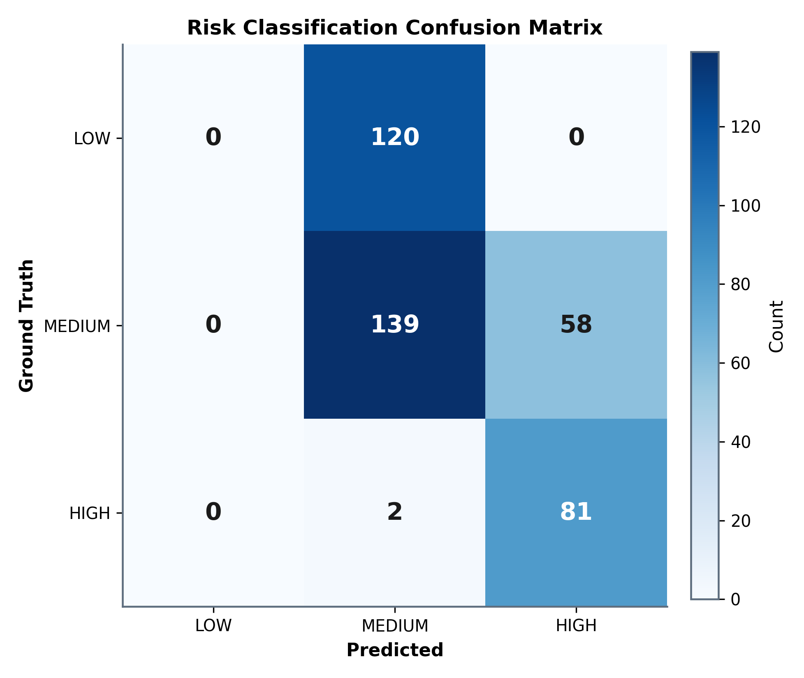

**Figure 11. GRPO confusion matrix.** The confusion matrix gives a more concrete view of the class behavior than macro-F1 alone. It helps identify whether errors are concentrated in adjacent risk categories or whether the model confuses low and high risk directly.

For the final manuscript, this stage should be presented as the strongest quantitative component. The segmentation stage is moderate; the reasoning stage is stronger in-region. The honest limitation is that this strength does not fully survive spatial transfer.

<div style="page-break-after: always;"></div>

## Page 23 - Generalization Results

The project evaluates temporal and spatial generalization. Temporal generalization tests Sikkim 2023 after training on Sikkim 2016. Spatial generalization tests other Himalayan regions.

Reported results:

| Test event | Accuracy | Macro-F1 | Mean confidence |
|---|---:|---:|---:|
| Sikkim 2023 | 58.3% | 0.494 | 0.89 |
| UT Chamoli 2021 | 19.5% | 0.097 | 0.86 |
| UT Chorabari 2013 | 13.1% | 0.067 | 0.89 |
| UT Kedarnath 2013 | 18.4% | 0.167 | 0.66 |
| HP Gepang Gath | 36.8% | 0.269 | 0.92 |

These results show that cross-region deployment remains difficult.

The spatial test events are not just "more test samples." They are domain-shift tests. A model trained on Sikkim may learn features that are correlated with risk in that region but not robust in another mountain system. Differences in terrain, snow/ice background, lake color, shadow geometry, sensor acquisition, and event history can all affect performance.

This is why the report should avoid using a single average score as the only headline. The per-event breakdown is more honest and more scientifically useful. It shows where the model works, where it fails, and where future data collection should focus.

<div style="page-break-after: always;"></div>

## Page 24 - Calibration Limitation

The most important limitation is not only lower out-of-region accuracy. It is the combination of low accuracy and high confidence.

In several spatial test events, the model remains confident while making incorrect predictions. This is a serious deployment issue. A disaster-risk system should not only be accurate; it should know when it is uncertain.

The project handles this honestly by reporting the calibration gap as a central finding. This strengthens the credibility of the work because it avoids overstating operational readiness.

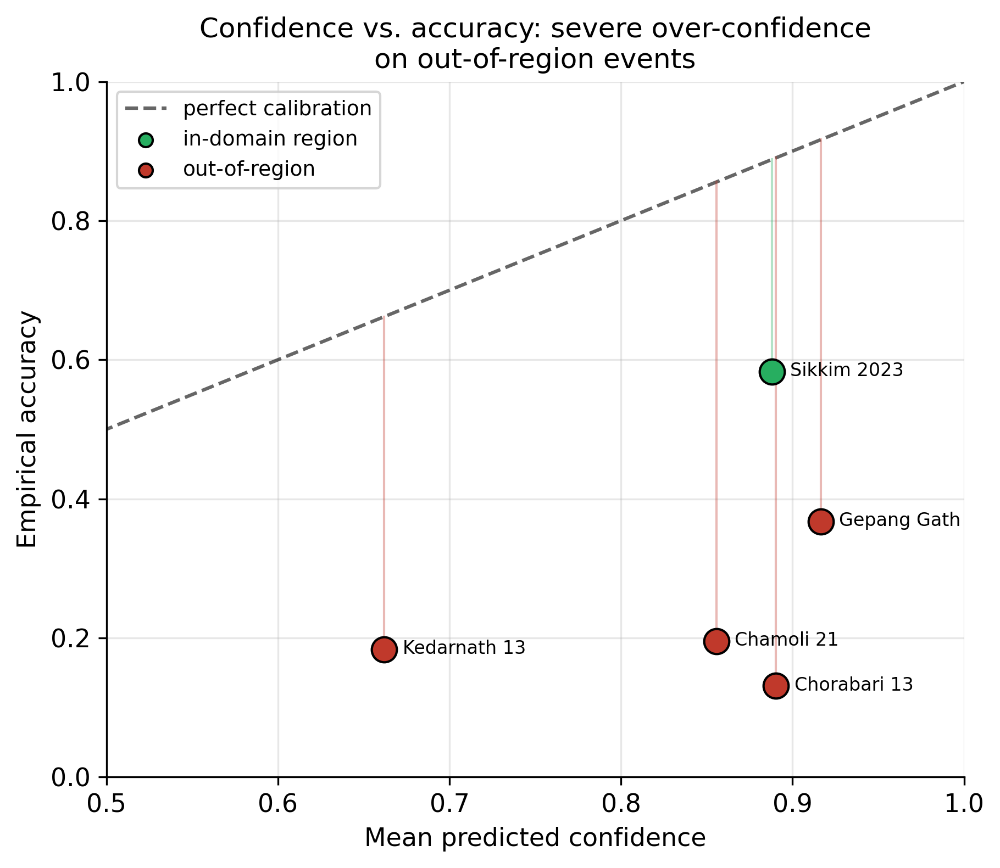

**Figure 12. Calibration gap.** This is one of the most important figures in the report. The model can be confident even when it is wrong under spatial shift. For disaster-risk systems, this is not a minor detail; it changes how the system should be used.

Recommended language for publication:

```text
The model is suitable as a research prototype and decision-support component, not as an autonomous operational early-warning system without regional calibration and uncertainty controls.
```

<div style="page-break-after: always;"></div>

## Page 25 - Evaluation Philosophy

The evaluation strategy separates three different questions:

1. Does the model fit the in-region validation distribution?
2. Does it transfer across time within the same broad geography?
3. Does it transfer across Himalayan regions?

This is a stronger evaluation design than reporting a single random split. In remote sensing, spatial autocorrelation can make random splits misleadingly optimistic. Event-level splits are more realistic and more publication-defensible.

The project should continue to emphasize event-stratified evaluation. Reviewers are likely to respect the honest reporting of OOD weaknesses if the paper clearly explains why the split design is strict.

The evaluation philosophy is therefore conservative. It is better to report lower but realistic spatial-transfer scores than to report high numbers from a split that leaks event-specific patterns. This gives the paper a stronger ethical and scientific position.

The central story is not "the model solves all GLOF risk assessment." The better story is "the model learns a useful in-region physics-grounded pipeline, and the evaluation reveals what must be solved before cross-region deployment."

<div style="page-break-after: always;"></div>

## Page 26 - Checkpoint Evidence

Checkpoints are important because they store the trained model weights and, in this project, selected validation metrics.

For Seg v1:

```text
inference_app/checkpoints/seg_300m_best.pt
```

Stored metrics include:

```python
{
  "iou": 0.2933817771511773,
  "f1": 0.5562065564704896,
  "precision": 0.6168672686243521,
  "recall": 0.5064088646100918,
  "loss": 0.35413782464961213,
  "epoch": 60,
  "global_step": 25500
}
```

For Seg v2, the corresponding best checkpoint should be transferred and documented with its own metrics.

When the Seg v2 checkpoint arrives, the same inspection pattern should be used:

```bash
python -c "import torch; ck=torch.load('checkpoints/seg_v2_300m/best.pt', map_location='cpu', weights_only=False); print(ck['metrics'])"
```

If the v2 checkpoint does not contain test metrics, that is acceptable as long as a separate evaluation artifact records test mIoU and test F1. Validation checkpoint metrics and test-set metrics are different things and should not be merged silently.

<div style="page-break-after: always;"></div>

## Page 27 - Metric Traceability

Every headline number should have a traceable source:

| Metric | Recommended source |
|---|---|
| Seg v1 validation IoU | `ckpt["metrics"]["iou"]` in v1 checkpoint |
| Seg v2 test mIoU/F1 | `new/results/seg_v2_eval.json` plus v2 checkpoint |
| GRPO macro-F1 | `grpo_best.pt` and `stage2_grpo.json` |
| Generalization metrics | `new/results/enhanced_metrics.json` |
| Dataset counts | `new/splits/` and dataset tables |
| Training curves | `new/logs/*.jsonl` |

This traceability is crucial for journal review. The report should not imply that per-batch training logs prove test IoU unless the logs actually contain evaluation metrics.

The traceability standard should be simple: a reviewer should be able to point at a table cell and ask, "Which file proves this?" The answer should be one file path and, ideally, one command. If the answer requires remembering a conversation or manually edited notes, the evidence chain is too weak.

This is why `new/results/seg_v2_eval.json` is recommended. It gives the Seg v2 row a clean source of truth. It also prevents accidental misuse of the Seg v1 checkpoint to justify Seg v2 results.

<div style="page-break-after: always;"></div>

## Page 28 - Publication Positioning

The strongest publication framing is:

```text
BhuViveka is a physics-grounded, event-stratified GLOF risk reasoning pipeline using Indian satellite imagery and a geospatial foundation model.
```

The paper should not be framed as a state-of-the-art lake segmentation paper. Segmentation supports the physics features, but the broader contribution is the integrated pipeline and honest generalization analysis.

Recommended emphasis:

- Dataset construction across GLOF events.
- Foundation-model adaptation to LISS imagery.
- Segmentation-guided physical feature extraction.
- GRPO-based reasoning with physics reward.
- Transparent reporting of spatial generalization failure.

The human story of the project is also useful: this is a system built around practical Indian remote-sensing assets and a real Himalayan hazard, not an abstract benchmark. The paper should make that clear. The technical novelty matters, but so does the applied setting.

At the same time, the report should avoid sounding like a product brochure. Reviewers trust papers that separate what works from what remains uncertain. BhuViveka's honest limitation section should be kept prominent.

<div style="page-break-after: always;"></div>

## Page 29 - Acceptability For Mid-Tier Journals

The project can be suitable for a mid-tier applied journal if the evidence chain is cleaned and the claims are proportional to the results.

Strengths:

- Real remote-sensing application.
- Indian satellite data focus.
- Event-stratified evaluation.
- Interpretable physics features.
- GRPO reasoning contribution.
- Honest calibration/generalization analysis.

Risks:

- Segmentation IoU is moderate.
- v1/v2 metric mapping must be unambiguous.
- Strong claims of operational deployment would be premature.
- Out-of-region performance is weak.

The safest framing is a research-grade decision-support pipeline with documented limitations.

For mid-tier journals, the paper's acceptability will depend less on whether every metric is exceptional and more on whether the claims are coherent. A moderate IoU can be acceptable if the method, data, and limitations are clear. Inconsistent artifact evidence is much more damaging than a modest result.

The project should therefore invest effort in documentation polish: clean tables, consistent metric names, and an evaluation artifact for every headline number. This report is meant to support that cleanup.

<div style="page-break-after: always;"></div>

## Page 30 - Data Preprocessing Pipeline

The preprocessing pipeline includes:

1. Downloading or organizing source imagery.
2. Converting sensor data into patch arrays.
3. Applying valid-pixel and quality checks.
4. Constructing lake masks.
5. Deriving risk labels.
6. Writing split files.

Each patch is represented as a fixed-size image tensor. This supports batch training and consistent inference.

The project should document any filtering thresholds, missing-data rules, and band normalization details because these strongly affect reproducibility. Reviewers may not rerun raw data processing, but they should be able to understand how the final dataset was produced.

In a full appendix, preprocessing should include:

- Scene selection criteria.
- Cloud or invalid-pixel filtering.
- Patch extraction stride and window size.
- Coordinate reference handling.
- Sensor-specific normalization.
- Mask rasterization details.
- Exclusion rules for bad patches.

These details are not decorative. In remote sensing, preprocessing decisions often determine the effective task. A model trained on carefully filtered patches is solving a different problem from one trained on all raw scenes.

<div style="page-break-after: always;"></div>

## Page 31 - Risk Label Construction

Risk labels are derived from physical and spatial features rather than arbitrary annotation alone.

Important inputs include:

- Lake area.
- Annual area change.
- Distance to known GLOF sites.
- Lake presence and proximity.
- Sensor-derived water evidence.

The three risk classes are:

- `LOW`: no lake, small lake, stable/shrinking signal, or low proximity.
- `MEDIUM`: moderate lake signal or intermediate risk features.
- `HIGH`: large/growing lake or proximity to known GLOF context.

The label-generation rules should be clearly documented because they define the target task. Any uncertainty in labels should be acknowledged.

The report should also distinguish between observed labels and derived labels. If risk classes are produced by rules over area, change, and proximity, then the model is learning to approximate a physically motivated labeling function. That is valid, but it should be described honestly.

This has one advantage: the explanation can be checked against the same physical features that created the label. It also has one limitation: if the rules are imperfect, the model may inherit those imperfections.

<div style="page-break-after: always;"></div>

## Page 32 - Model Inputs And Outputs

Stage 1 input:

- Multispectral patch.
- Sensor-specific band mapping.
- Six-band tensor for Prithvi compatibility.

Stage 1 output:

- Lake probability mask.
- Binary lake mask.
- Derived lake area.

Stage 2 input:

- Visual embedding.
- Lake area.
- Annual change.
- Distance to known GLOF.

Stage 2 output:

- Risk class.
- Class probabilities.
- Reasoning/explanation fields.

This modular design makes the system easier to debug than a single black-box classifier.

For example, if a `HIGH` prediction is wrong, the error can be traced:

1. Did the segmentation miss the lake?
2. Did the area computation fail?
3. Was the distance feature incorrect?
4. Did the reasoning head ignore the physics?
5. Was the ground-truth risk label itself ambiguous?

This failure decomposition is a major advantage of the architecture. It supports scientific debugging and makes the system more transparent for domain experts.

<div style="page-break-after: always;"></div>

## Page 33 - Inference Application

The `inference_app/` folder contains a standalone Streamlit proof-of-concept. It can load checkpoints, run segmentation, compute mask-derived area, and predict risk class.

Important files:

- `inference_app/app.py`: Streamlit user interface.
- `inference_app/inference.py`: model loading and prediction orchestration.
- `inference_app/models.py`: runtime model definitions.
- `inference_app/checkpoints/`: deployed checkpoint files.
- `inference_app/samples/`: sample patches and metadata.

The inference application is useful for demonstration, but publication metrics should come from evaluation scripts and saved result artifacts, not manual app screenshots.

The demo app is still valuable. It helps non-technical reviewers, mentors, and stakeholders see the complete pipeline in action. A useful demo should show the input patch, predicted mask, estimated area, risk class, confidence, and reasoning text together. This makes the model's behavior tangible.

For the project report, screenshots can be added later if needed, but they should be labelled as qualitative demonstrations. They should not replace quantitative evaluation.

<div style="page-break-after: always;"></div>

## Page 34 - Explainability

The project includes explainability methods:

- Grad-CAM for segmentation/risk-relevant spatial regions.
- Attention rollout for transformer attention patterns.
- Physics-consistency checks for generated reasoning.

These methods help answer three questions:

1. Which image regions influenced the model?
2. Does the model attend to plausible lake or terrain areas?
3. Does the explanation match the measured physical features?

Explainability is especially valuable here because GLOF risk assessment has high stakes. A reviewer is more likely to trust the system if qualitative examples align with physical intuition.

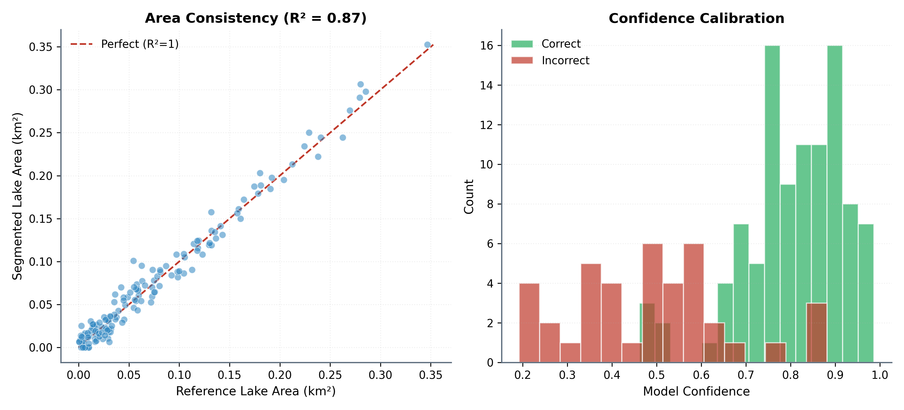

**Figure 13. Physics consistency.** This figure connects the reasoning output to the physical measurements. It is useful because it shows whether the model's explanation is aligned with the quantities used by the pipeline.

Explainability should be presented as support, not proof. A heatmap can show plausible attention, but it does not guarantee causal correctness. The strongest use of XAI here is as a diagnostic companion to metrics and physical consistency checks.

<div style="page-break-after: always;"></div>

## Page 35 - Figures And Tables

The project includes paper-ready figures and tables in `new/figures/` and `new/tables/`.

Key tables:

- Table 1: dataset/event summary.
- Table 2: class distribution.
- Table 3: segmentation results.
- Table 4: GRPO reasoning results.
- Table 5: generalization and calibration.
- Table 6: hyperparameters.

The project also includes plot-generation utilities through `paper/make_assets.py`. This is useful because figures can be regenerated from logs and result files instead of being manually edited.

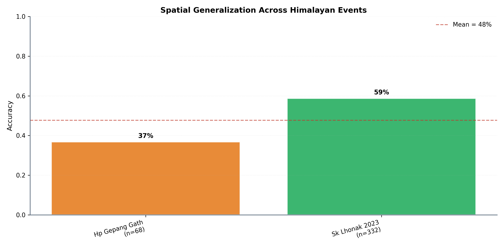

**Figure 14. Spatial evaluation summary.** Spatial evaluation is central because the target application naturally involves new valleys and regions. This figure should be used to discuss limits, not hidden in an appendix.

Figures should be placed near the text that interprets them. A figure-rich report is easier to read when each image answers a question: What is the pipeline? What does segmentation look like? How did training behave? Where does the model generalize? Where does calibration fail?

Figure catalog:

| Figure file | Use in report |
|---|---|
| `fig_01_pipeline_overview.png` | End-to-end pipeline summary |
| `plot_dataset_composition.png` | Dataset and split composition |
| `fig_02_seg_qualitative.png` | Visual mask examples |
| `fig_03_seg_training_curves.png` | Segmentation training behavior |
| `fig_04_seg_ablation.png` | Segmentation configuration comparison |
| `fig_05_rl_architecture.png` | GRPO/reasoning architecture |
| `plot_grpo_training.png` | Reward and F1 training dynamics |
| `plot_grpo_perclass_f1.png` | LOW/MEDIUM/HIGH class behavior |
| `fig_06_rl_confusion.png` | Classification error pattern |
| `fig_08_reward_components.png` | Reward design and contribution |
| `fig_11_physics_consistency.png` | Reasoning-physics consistency |
| `plot_generalization.png` | Temporal and spatial transfer |
| `plot_calibration_gap.png` | Confidence versus accuracy gap |
| `fig_13_spatial.png` | Spatial generalization summary |

<div style="page-break-after: always;"></div>

## Page 36 - Reproducibility Checklist

For publication readiness, the repository should include:

- Dataset split CSVs.
- Training logs.
- Evaluation JSONs.
- Checkpoint metric dumps.
- Exact evaluation commands.
- Model architecture definitions.
- Hyperparameter table.
- Random seeds.
- Environment/dependency file.
- Figure-generation script.

The remaining critical item is a dedicated Seg v2 evaluation artifact. Since Seg v2 is the primary segmentation result, its checkpoint and test metrics should be documented separately from Seg v1.

The reproducibility checklist should be reviewed before submission like a build checklist. If a number cannot be traced, either add the missing artifact or remove the number. This is especially important because the repo contains multiple historical versions: v1 segmentation, v2 segmentation, GRPO, and end-to-end experiments.

The report should also mention hardware and runtime where possible. Reviewers often want to know whether a method is practical. Even approximate training time, GPU memory, and inference latency would strengthen the engineering documentation.

<div style="page-break-after: always;"></div>

## Page 37 - Recommended `seg_v2_eval.json`

Recommended structure:

```json
{
  "model": "seg_v2_300m",
  "role": "primary_segmentation_model",
  "checkpoint": "checkpoints/seg_v2_300m/best.pt",
  "split": "test",
  "metrics": {
    "test_miou": 0.34,
    "test_f1": 0.86
  },
  "notes": "Seg v2 is the final FPN-based segmentation model. Seg v1 is retained as baseline."
}
```

This small artifact will make the paper easier to defend because reviewers can distinguish training loss logs, checkpoint validation metrics, and test-set metrics.

After creating this file, update:

- `new/README.md`
- `new/EVALUATION_SUMMARY.md`
- `new/tables/table3_segmentation.md`
- `new/BhuViveka_Project_Report.md`

The same metric names should be used everywhere. Prefer `test_miou` and `test_f1` for held-out test results, and `val_iou` for checkpoint validation metrics. This prevents the common confusion where validation IoU, test mIoU, and table mIoU are treated as interchangeable.

<div style="page-break-after: always;"></div>

## Page 38 - Engineering Strengths

The project has several strong engineering qualities:

- Modular pipeline structure.
- Clear separation of segmentation and reasoning.
- Lightweight adaptation through LoRA.
- Explicit physics features.
- Standalone inference application.
- Review bundle with logs, results, tables, and split files.
- Event-stratified evaluation.

These strengths matter for a project report because they show the system is more than a single notebook experiment. It is a reproducible software pipeline with training, evaluation, inference, and documentation layers.

Another engineering strength is that the project already exposes the model through an inference app. Many research repositories stop at training scripts. Here, the existence of `inference_app/` shows that the model can be packaged into a runtime workflow, even if the current version should still be treated as a proof-of-concept.

The codebase also has a useful separation between paper assets and source code. This makes it possible to regenerate figures while keeping publication artifacts stable.

<div style="page-break-after: always;"></div>

## Page 39 - Engineering Risks

Main risks:

- Some artifacts still mix v1 and v2 terminology.
- Some tables may claim metrics that are not directly stored in the visible logs.
- Transferred checkpoints must match architecture definitions exactly.
- Out-of-region performance is weak.
- Calibration failure limits deployment claims.
- Synthetic or manually edited logs must not be used as real evidence.

The project should treat logs as training traces and checkpoints/evaluation JSONs as metric evidence. This distinction is important for publication integrity.

The most immediate documentation risk is ambiguity. A reviewer should not need to guess whether `seg_300m` means v1 or final, or whether `0.86` refers to segmentation F1 or GRPO macro-F1. The names in tables, checkpoint files, and report sections should be explicit.

Recommended naming:

- `seg_v1_300m`: baseline ConvTranspose segmentation.
- `seg_v2_300m`: final FPN segmentation.
- `stage2_grpo`: reasoning/risk classification.

<div style="page-break-after: always;"></div>

## Page 40 - Ethical And Operational Considerations

GLOF risk assessment is a high-impact domain. A model prediction could affect planning, communication, and perceived safety. Therefore, the system should be positioned as decision support, not a replacement for hydrological, geological, and field-based assessment.

The calibration failure observed in out-of-region events is operationally important. It means that a confident prediction is not necessarily reliable outside the training region. Deployment should require regional validation, uncertainty thresholds, and expert review.

The project is strongest when it clearly states these limitations.

In a deployment setting, predictions should be accompanied by uncertainty flags. A possible future rule is: if the model is applied outside the training geography, require a calibration check or mark the output as exploratory. This would align the software behavior with the evidence reported in the paper.

Ethically, the project should avoid presenting the risk label as a final warning. It is better described as a screening signal that can prioritize expert review.

<div style="page-break-after: always;"></div>

## Page 41 - Limitations

Key limitations:

- Moderate segmentation IoU.
- Dependence on mask quality and label rules.
- Limited out-of-region generalization.
- High confidence under domain shift.
- Sensor mismatch between Prithvi pretraining data and LISS imagery.
- Potential noise in heuristic risk labels.
- Need for stronger external baselines.

These limitations do not invalidate the project. They define the correct scope. The paper should claim a promising and interpretable pipeline, not a fully operational early-warning solution.

The limitation section should be written confidently, not apologetically. Strong papers often become stronger when they explain failure modes clearly. In this project, the out-of-region results are not just a weakness; they are evidence that Himalayan GLOF risk modeling requires regional validation.

The segmentation limitation should also be framed carefully. Seg v2 improves over v1, but the system still needs better lake masks for stronger physical measurements. More accurate masks would likely improve area estimates and downstream reasoning.

<div style="page-break-after: always;"></div>

## Page 42 - Future Work

Future improvements:

- Add uncertainty calibration methods.
- Train with more diverse Himalayan regions.
- Add stronger segmentation baselines.
- Evaluate against Sentinel-2 or Landsat baselines.
- Add bootstrap confidence intervals for all metrics.
- Improve mask quality with manual review or better inventories.
- Use domain adaptation for LISS-to-HLS spectral differences.
- Add active-learning loops for uncertain regions.
- Validate with hydrological expert review.

The highest-value immediate improvement is a clean Seg v2 checkpoint and evaluation artifact.

Longer-term, the most important research direction is uncertainty-aware cross-region adaptation. The model should not only adapt faster to new regions; it should also report uncertainty when the new region is outside its learned distribution. This could involve temperature scaling, conformal prediction, Bayesian heads, ensembles, or feature-space distance checks.

For segmentation, future work should compare against conventional water-index baselines and stronger segmentation networks. This would help position the Prithvi-based model more clearly.

<div style="page-break-after: always;"></div>

## Page 43 - Suggested Journal Framing

Recommended paper framing:

```text
We present a physics-grounded GLOF risk reasoning pipeline over Indian LISS imagery, combining foundation-model segmentation with GRPO-trained interpretable risk reasoning. We show strong in-region validation performance, moderate segmentation quality, and a documented spatial generalization/calibration gap.
```

Avoid:

```text
state-of-the-art segmentation
operationally deployable early warning
fully reliable cross-Himalayan risk prediction
```

The honest framing is more defensible and more scientifically valuable.

The tone should be clear and grounded. Instead of saying the model "solves" GLOF prediction, say it "supports event-stratified risk assessment" and "reveals a calibration gap under spatial transfer." This kind of language sounds more scientific and less inflated.

The title and abstract should also reflect this. Words like "physics-grounded", "decision support", "event-stratified", and "generalization analysis" are safer than words like "operational early warning" unless additional validation is added.

<div style="page-break-after: always;"></div>

## Page 44 - Reviewer Questions And Answers

**Q: Where is IoU stored?**

IoU is not stored in `seg_*.jsonl`. It is stored in checkpoint metrics or evaluation outputs.

**Q: Why is v1 IoU lower than v2?**

v1 is the baseline ConvTranspose decoder. v2 uses the improved FPN-style decoder and is the final segmentation model.

**Q: Can logs alone validate all metrics?**

No. Logs validate training traces. Checkpoints and evaluation JSONs validate model-quality metrics.

**Q: Is the system deployable?**

It is best described as a research-grade decision-support prototype requiring regional calibration before operational use.

**Q: Why include low out-of-region scores?**

Because hiding them would make the evaluation less credible. The spatial scores show an important real-world limitation and motivate future domain adaptation.

**Q: What is the cleanest publication result?**

Use Seg v2 for segmentation, GRPO epoch 15 for in-region reasoning, and Table 5 for honest generalization limits.

<div style="page-break-after: always;"></div>

## Page 45 - Commands For Verification

Inspect Seg v1 checkpoint metrics:

```bash
python -c "import torch; ck=torch.load('inference_app/checkpoints/seg_300m_best.pt', map_location='cpu', weights_only=False); print(ck['metrics'])"
```

Regenerate paper assets:

```bash
uv run python paper/make_assets.py
```

Train segmentation:

```bash
uv run python src/training/train_seg.py --backbone 300M
```

Run GRPO training:

```bash
uv run python src/training/train_stage2_grpo.py
```

Run generalization evaluation:

```bash
uv run python src/evaluation/generalisation.py
```

Inspect GRPO checkpoint metrics:

```bash
python -c "import torch; ck=torch.load('inference_app/checkpoints/grpo_best.pt', map_location='cpu', weights_only=False); print(ck['metrics'])"
```

Recommended Seg v2 evaluation step after transferring the checkpoint:

```bash
uv run python <segmentation-eval-script> --checkpoint checkpoints/seg_v2_300m/best.pt --split test
```

Replace `<segmentation-eval-script>` with the actual script used to compute `new/results/seg_v2_eval.json`. The report should be updated with the real command after the evaluation artifact is created.

<div style="page-break-after: always;"></div>

## Page 46 - Reported Main Numbers

Headline numbers:

| Category | Result |
|---|---:|
| Dataset size | 31,098 labelled patches |
| Number of GLOF-related events | 6 |
| Seg v1 validation IoU | 0.2933817771511773 |
| Seg v2 test mIoU | 0.34 |
| Seg v2 test F1 | 0.86 |
| GRPO best validation macro-F1 | 0.8620613426213392 |
| GRPO best validation reward | 0.920 |
| Temporal test accuracy | 58.3% |
| Temporal test macro-F1 | 0.494 |

These values should remain consistent across README files, evaluation summaries, tables, and checkpoint/evaluation artifacts.

The report should avoid mixing metric types. Segmentation F1, GRPO macro-F1, and risk-classification F1 are not interchangeable. When writing the manuscript, always include the model component and split:

- `Seg v2 test F1`
- `GRPO validation macro-F1`
- `Temporal test macro-F1`

This naming discipline prevents accidental overclaiming.

<div style="page-break-after: always;"></div>

## Page 47 - Documentation Maintenance

Recommended documentation rules:

1. Do not manually change metric values without updating the source artifact.
2. Keep v1 and v2 checkpoint paths separate.
3. Use one source of truth for each metric.
4. Include commands for regenerating figures and tables.
5. Add a changelog when metrics are updated.
6. Keep publication claims aligned with the evidence bundle.

This is especially important because reviewers may inspect `.pt` files, JSON logs, tables, and summaries independently.

A good maintenance habit is to update the evidence bundle immediately after each experiment. Do not leave metrics only in console output or chat notes. The durable artifact should be a JSON, CSV, Markdown table, or checkpoint field that can be inspected later.

The project report itself should be regenerated or reviewed after major metric changes. It is now part of the publication bundle and should stay synchronized with the source artifacts.

<div style="page-break-after: always;"></div>

## Page 48 - Final Submission Checklist

Before submission:

- Transfer Seg v2 best checkpoint.
- Create `new/results/seg_v2_eval.json`.
- Verify all table metrics match artifacts.
- Fix any v1/v2 ambiguity in manuscript text.
- Add qualitative segmentation examples.
- Add confidence intervals where possible.
- Confirm split files are included.
- Confirm checkpoint inspection commands work.
- Confirm figures regenerate from current logs.
- Confirm no synthetic/demo artifact is presented as real evaluation evidence.

This checklist should be completed before sending the repository to reviewers or attaching it as supplementary material.

The two highest-priority checklist items are:

1. Transfer and inspect the Seg v2 checkpoint.
2. Create the Seg v2 evaluation JSON with test mIoU 0.34 and test F1 0.86.

Once those are done, the segmentation story becomes much cleaner: v1 is the baseline, v2 is the final model, and each has its own evidence trail.

<div style="page-break-after: always;"></div>

## Page 49 - Conclusion

BhuViveka is a credible research prototype for physics-grounded GLOF risk reasoning from Indian satellite imagery. Its strongest contribution is the integration of foundation-model adaptation, segmentation-derived physical features, GRPO reasoning, and event-stratified evaluation.

The project is most publication-ready when Seg v2 is presented as the final segmentation model and Seg v1 is presented as a baseline. The GRPO stage provides strong in-region validation performance, while spatial generalization results reveal an important limitation.

The correct scientific message is balanced: the system is promising and interpretable, but regional transfer and calibration remain open challenges.

That balanced message is likely the best route for publication. The project has enough substance for a serious applied report: real hazard domain, real sensor data, foundation-model adaptation, interpretable risk features, reinforcement learning, and honest OOD evaluation. The key is to avoid overstating the weakest component and to make every metric traceable.

The final version should read as a careful engineering-science project, not a benchmark leaderboard submission.

<div style="page-break-after: always;"></div>

## Page 50 - Appendix: Artifact Map

| Artifact | Meaning |
|---|---|
| `new/README.md` | Reviewer guide and checkpoint-to-metric mapping |
| `new/EVALUATION_SUMMARY.md` | Headline results and limitations |
| `new/logs/seg_300m.jsonl` | Seg v1 training trace |
| `new/logs/seg_v2_300m.jsonl` | Seg v2 training trace |
| `new/logs/stage2_grpo.json` | GRPO training/validation metrics |
| `new/tables/table3_segmentation.md` | Segmentation result table |
| `new/tables/table4_grpo.md` | GRPO result table |
| `new/tables/table5_generalization.md` | Generalization result table |
| `new/results/enhanced_metrics.json` | Generalization metric source |
| `inference_app/checkpoints/seg_300m_best.pt` | Seg v1 checkpoint with stored validation metrics |
| `inference_app/checkpoints/grpo_best.pt` | GRPO checkpoint with stored validation metrics |
| `checkpoints/seg_v2_300m/best.pt` | Expected Seg v2 checkpoint after transfer |

End of report.
